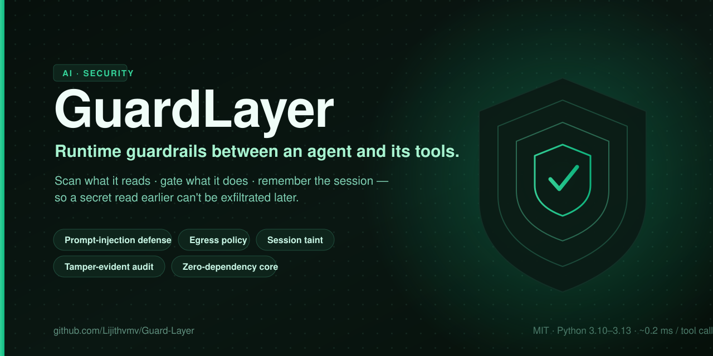

<p align="center">
  
</p>

# GuardLayer

> Stop an AI agent from doing harm after it reads something an attacker wrote.

GuardLayer sits between an agent and its tools. It checks what the agent **reads**, decides whether what it is about to
**do** may run, needs a human, or is refused, and remembers what the session has already seen, so an action is judged in
context. Pure Python, zero dependencies, no model needed: about 5 ms per tool call and 50 ms per 4 KB tool result in
the Claude Code hook server on a laptop.


**Documentation: https://lijithvmv.github.io/Guard-Layer/**

## Why this approach

Any text an agent reads (a web page, an email, an issue, a tool result) can carry instructions, and the model can't
reliably tell them apart from yours. Detectors catch a minority of attacks they have never seen (numbers below), and
an attack written as a plain request reads like any other. So GuardLayer doesn't depend on recognising the attack. It
judges each action by **what it would do and what it carries**:

1. **Local work runs.** Editing, building, testing and reading this machine's files are recoverable, and nothing
   leaves. Holding them only teaches people to approve without reading.
2. **Data leaving to a place an outsider named is held.** GuardLayer remembers, as keyed hashes, the places and values
   that appeared in content an outsider could write (a web page, an email, a downloaded or cloned file) and in your own
   messages. An action that sends something private to a place only an outsider named waits for you. Following a link
   carries nothing, so it runs.
3. **Irreversible actions are judged by who chose them.** A payment, a deletion, a push, a password or access change
   is held when an outsider chose its target or an injection was read; deleting the agent's own scratch files is not.
4. **Trust is stated, never guessed from a name.** A tool's output counts as yours only if you (or an integration, for
   its own tools) said so; `read_file` on a shared drive, a chat channel or a calendar can carry someone else's text.
5. **Secrets and the usual dangers are always checked:** a secret read earlier and now being sent out is blocked;
   destructive commands, credential files and exfiltration endpoints are refused. Every decision goes to a
   tamper-evident audit log.

How it works, and what it does not cover: [Judging an action by its consequence](https://lijithvmv.github.io/Guard-Layer/concepts/consequence/).

## Quickstart: Claude Code

```toml
# pilot.toml: record what would happen, enforce nothing
preset = "observe"

[audit]
path = "pilot-audit.jsonl"
min_verdict = "allow"
```

```bash
pip install guardlayer
guardlayer --config pilot.toml hook claude-code --print-config     # merge into the project's .claude/settings.json
guardlayer audit report pilot-audit.jsonl --since-days 1           # what it would have stopped or asked, daily
```

Nothing is blocked in `observe` mode. After a week of real work, switch the preset to `balanced` (the defaults: on
replays of real Claude Code sessions they held about 1.7% of calls for approval; see below). The hook only
ever tightens Claude Code's own permissions (it returns `deny` or `ask`, never `allow`). Each hook call starts a Python
process (about 0.6 s on Windows); add `--server` for a background GuardLayer that answers in about 10 ms. See the [pilot guide](https://lijithvmv.github.io/Guard-Layer/getting-started/pilot/).

## Quickstart: your own agent

```python
from guardlayer import GuardLayer

guard = GuardLayer.from_preset("balanced")
session = guard.session(conversation_id)

# after a tool runs, before the model reads the result
result = session.scan_tool_result("read_email", email_text)
email_text = result.text                      # secrets redacted; withhold it if result.is_blocked

# before a tool runs
check = session.scan_tool_call("send_email", {"to": to, "body": body})
if check.is_blocked:
    refuse(check)
elif check.needs_review and not ask_a_human(check):
    refuse(check)
```

LangGraph, the OpenAI Agents SDK and any other framework have ready-made wrappers:
[integrations](https://lijithvmv.github.io/Guard-Layer/integrations/any-framework/).

## Describe your tools

This is where most of the protection comes from. Out of the box, GuardLayer guesses from tool names (`bash` runs
commands, `http_get` reaches the network) and treats unknown tools as able to do anything. Telling it the truth, once per
tool, makes it both safer and quieter:

```toml
# guardlayer.toml
preset = "balanced"

[tool.read_email]
output = "untrusted"               # others can write what it returns

[tool.send_email]
capabilities = ["network"]
accepts_untrusted = false          # a session that read untrusted content may not drive it
arguments = [{ argument = "to", allow = ["*@mycompany.com"], action = "review" }]
```

`guardlayer --config guardlayer.toml policy check` lists every tool and what GuardLayer assumes about it.
All keys: [configuration](https://lijithvmv.github.io/Guard-Layer/operations/configuration/).

## What the evidence says

Weakest first. Each result says what kind of data it rests on. Everything is reproducible from `benchmarks/`; the full
write-up is in [Evaluation](https://lijithvmv.github.io/Guard-Layer/evaluation/) and
[Judging an action by its consequence](https://lijithvmv.github.io/Guard-Layer/concepts/consequence/).

**Read this first: many attack numbers below are not independent tests.** GuardLayer's rules were developed by
studying where they failed on AgentDojo's published runs, Invaris AgentSec's suite and, later, InjecAgent and ASB;
results on that data show the rules fit it. Each row says whether it is tuned. Results on data never used during
development are marked **unseen**; the first of those were weak, and are shown first.

**Not measured yet:** an attacker who adapts to these rules; harm done only through text (a misleading answer); live
use beyond one developer's pilot; a second user; teams. Nothing here is a robustness guarantee.

| Test | Data | Result | How much to trust it |
|---|---|---|---|
| First contact with a benchmark never used before | InjecAgent (ACL 2024): the authors' released outputs of every prompted model, 9,174 attacks that succeeded | **19%** of attacks that do damage with no destination stopped (909 of 4,868); 92% of data-stealing attacks | **unseen, untuned**: the honest starting point; it exposed the gap the rules below were built for |
| First contact, live agent | ASB (ICLR 2025) observation injection, run locally with a 14B model (its own runner sends telemetry, so its data and attack text were reused in a local runner) | **1 of 24** attacks that succeeded stopped; 0 of 30 normal runs held | **unseen, untuned**; small |
| After the fixes, judged on attacks kept sealed while building | InjecAgent's "enhanced" attacks on the half of its attacker tools not used for building | direct harm stopped **26% to 51%** by default (**31% to 44%** without 5 tools whose names were seen earlier); 57% with the opt-in rule below | **unseen**, but same tools and instructions as a half looked at once (totals only) |
| Against other defences, same recorded attacks | AgentDojo runs of 24 models never used for building: 2,342 attacks with a harmful call, 2,271 ordinary tasks; each defence in GuardLayer's place | GuardLayer: **98.3%** stopped, **5.5%** of tasks interrupted. A published 2026 provenance-gating defence: 100% / 50.7% (strict), about 90% / 37-40% (selective). A decision-runtime guard: 99.96% / 73.8% (firewall), 86.8% / 37.7% (grounding) | **unseen models**; their adapters written by us from their documentation (none is published); replay, not live. A defence that rebuilds the agent reports 0 of 949 attacks at 27 points of task completion (its paper): stronger on attacks, not replayed. [Details](https://lijithvmv.github.io/Guard-Layer/evaluation/) |
| Ordinary work on models never used for building | AgentDojo's published runs of 24 other models, 2,916 ordinary tasks and 2,342 attacks with a state-changing harmful call | ordinary tasks held **12.8% to 8.5%**; harmful calls held unchanged: **2,303** (detectors on) and **2,165** (detectors removed) of 2,342 | **unseen models** (looked at twice), same tasks and attacks as the tuned rows |
| An outside attack suite, first run, before any change for it | Invaris AgentSec (35 scenarios, a deliberately vulnerable agent that obeys every instruction) | **0 of 35** stopped out of the box (no call withheld); with the suite's allowed tools declared, 19 of 35 still found problems | untuned: the honest out-of-the-box result. Later rules made for this suite bring it to 30 (none declared) and 16 (declared), but those are tuned |
| Interruptions on real work | replay of one developer's Claude Code sessions, 6,962 calls from projects not used to design the rules (but used to check every change) | **1.7%** of calls held for approval (`balanced`; 121 calls) | real use, one person |
| Live pilot, watching only | one developer's own Claude Code use, 791 calls over two days of security research (reading attack datasets) | **6.7%** would have been held (version of 2026-10-11) | real use, live, one person, an unusually hostile workload |
| Interruptions on someone else's agents | 200 OpenHands runs resolving real GitHub issues, 12,049 calls (third-party recorded, CC BY 4.0) | **0.54%** held with no setup; **0.18%** with its five tools declared | different model, framework and people; no attacks in it |
| Attacks no detector recognises | AgentDojo's published runs of five frontier models (Claude 3.7/3.5 Sonnet, GPT-4o, Gemini 2.0 Flash, Llama 3.3 70B), 707 attacks that succeeded; GuardLayer's detectors switched off | **76%**: the attack's own harmful call held (85% with detectors on); some call in the run held: 90% (99%). Counting a harmful call as one the agent didn't make without the attack: 623 of 673 (660 with detectors). **9%** of their ordinary tasks held (27% before the rules developed on these runs) | **tuned on**: the rules were developed on these runs; third-party recorded; one published attack family; replay |
| Plainly worded attacks | AgentDojo `direct` runs, GPT-4o and Llama 3.3 | earlier defaults (which leaned on detection) 10/23 and 11/34; now **22/23** and **32/34** | small; tuned on (studied before the fix) |
| Against a model-based trace judge | the same 85 recorded attacks and 40 ordinary tasks, an open-source LLM alignment checker run locally on a 14B model | attacks stopped: GuardLayer **82**, judge 80; ordinary tasks held: **12%** vs 28%; per decision ~0.01 s vs ~50 s | **not an independent comparison**: sampled from the runs GuardLayer's rules were developed on; the judge ran on a 14B model, far smaller than its authors use; small samples, overlapping intervals |
| Detection, held-out public datasets (never used to tune) | public datasets | recall 0.23 (deepset), 0.57 (Gandalf), 0.21 (SPML), 0.72 (jailbreak-classification); **no false positives** on about 7,200 normal texts | solid; shows detection alone is not enough |
| Detection, LLMail-Inject attacks that hijacked a real model, held-out teams | public dataset | 44.5% caught, 0 false positives on its normal emails | solid for email-style injection |
| ADR-Bench: 303 recorded sessions with 134 MCP servers, no tools declared (version 0.8.1) | third-party recorded | 4% of normal sessions interrupted on the held-out half; 0 of 23 malicious sessions | the malicious cases are tool servers with normal-looking output: undeclared, they can't be told apart |

When an attack is caught in a tool result, the result is withheld, so the agent usually can't finish the user's task
in that case.

## What it doesn't do

- It lowers risk; it doesn't make prompt injection impossible. Detector signatures can be paraphrased around; the
  rules that don't depend on detection have their own measured gaps: an address the agent has to rebuild (spelled out,
  reversed), visiting an outsider's page, a password change with no destination, and private data paraphrased into a
  public post. See [what it stops and what it does not](https://lijithvmv.github.io/Guard-Layer/concepts/consequence/).
- **Implicit flows.** Outside text that makes the agent *choose* between values you trust (pay the second of your two
  invoices, invite the colleague you named rather than the other one) copies nothing from the outsider, so provenance
  rules can't see it. Neither can they see harm done only in the agent's answer text.
- **Poisoned records.** If an outsider can edit a record you rely on (a CRM's billing e-mail), a request that uses that
  record ("send the invoice to our billing contact") sends to the outsider's value: it is data, in a real field,
  indistinguishable from a correct one.
- It only sees what passes through it: tools you don't route through GuardLayer aren't guarded.
- An injection that stays within what the task allows (a wrong but permitted recipient, a misleading summary) needs
  argument rules or a human, not a scanner.

Assets, assumptions and residual risk: [THREAT_MODEL.md](https://github.com/Lijithvmv/Guard-Layer/blob/main/THREAT_MODEL.md).

## Core and add-ons

| Core (the product) | Add-ons (opt-in; **experimental** ones may change; see [What's stable](https://lijithvmv.github.io/Guard-Layer/reference/stability/)) |
|---|---|
| Tool-call policy, session tracking and labels, content scanners (injection, secrets, PII, links, obfuscation), presets and observe mode, audit log, Claude Code hook, Python API, LangGraph and OpenAI Agents SDK wrappers | Compliance evidence export (OWASP, ATLAS, NIST, ISO 42001, EU AI Act mappings) · signed audit logs (`signing`) · REST API (`api`) · transformer classifier (`ml`, `multilingual`) · semantic similarity (`embeddings`) · *experimental:* task profiles, file labels, split-instruction detection, PDF/image extraction (`extract`, `ocr`), behavioural check (`check_intent`) |

## Install

```bash
pip install guardlayer                      # core, no dependencies
pip install "guardlayer[signing]"           # + Ed25519-signed audit logs
pip install "guardlayer[langgraph]"         # or [openai-agents]: framework wrappers
pip install "guardlayer[api]"               # + REST API
```

The other extras are listed in [Install](https://lijithvmv.github.io/Guard-Layer/getting-started/install/).

## Development

```bash
pip install -e ".[dev]"
pytest -q
ruff check src tests
```

See [CONTRIBUTING.md](https://github.com/Lijithvmv/Guard-Layer/blob/main/CONTRIBUTING.md) and
[SECURITY.md](https://github.com/Lijithvmv/Guard-Layer/blob/main/SECURITY.md).

## License

[MIT](https://github.com/Lijithvmv/Guard-Layer/blob/main/LICENSE) © Lijith V M
